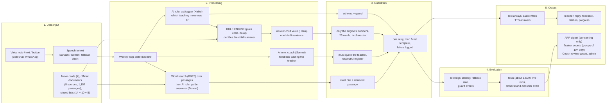

# Build-stage deck: slide-by-slide outline

The submission asks for a short deck with exactly these sections: **AI/LLM usage in layers** (data input, processing,
guardrails, evaluation, output), **guardrails**, **ability to work in real scenarios** (low connectivity, low-cost
devices, what degrades offline), **user inputs and testing** (1 to 2 pages) and **future roadmap** (1 to 2 pages).
Slides 1 and 2 are only the title and the one-line problem so a reader knows what the rest is about; every other slide
sits under one of the five required sections. 14 slides in total.

**Rules for the numbers.** Every number below is copied from a file in this repository and the file is named next to
it. Where there is no measurement the slide says so in words, in the same size as the rest. No figure here was
invented. Re-copy the numbers after the final run (the source files are listed at the end).

---

## Slide 1: Title

- **Abhyas (अभ्यास): a voice-first Hindi practice partner for Class 1 to 3 teachers.**
- AI for Foundational Learning Hackathon 2026, Challenge 3: Teacher Support and Training. Team Asymptotes
  (Shashwat Khandelwal, Vedant Arora, Divyansh Agrawal; names as in `README.md`).
- Hosted demo link and repository link (from the submission form: **needs a person**).
- Team photo (**needs a person**, `docs/deck_assets/`).

## Slide 2: The problem, in one line

- Teachers are trained in teaching moves but almost never get to practise them; trainers see attendance, not change.
- Abhyas: fifteen minutes a week, by voice, in Hindi, with a simulated child whose mistakes are real
  misconceptions, then coach feedback on the teacher's own words.
- Speaker note: say "the children's answers come from fixed rules, not from an AI model" here; it is the thread
  through every later slide.

---

# Section A: AI/LLM usage in layers

## Slide 3: The layers at a glance (the data-flow diagram)

Show this diagram (Mermaid source; render it in any Mermaid viewer or redraw it in the deck tool):

- One sentence under the diagram: "Thirteen model roles, every one schema-checked and guarded; none of them decides
  what a child answers."

## Slide 4: Layer 1, data input

- What comes in: voice notes, typed text, button taps (web PWA and WhatsApp); speech to text through Sarvam or Gemini
  with automatic fallback (a rate-limited provider is skipped for a minute; both failing asks the teacher to type).
- Teaching content we wrote: 4 move cards (all `in_review`, **no coach approval yet**), 14 class struggles,
  10 handbook questions, 5 teaching skills; every list item tied to a real passage and checked by a test.
- Official documents: NIPUN Bharat, NCERT Vidya Pravesh, NISHTHA FLN, two UP Class 1 guides in Hindi (read from
  page images by an AI step; citations say so): **1,157 passages**, each with its page.
- Not stored: the teacher's voice (read into memory, transcribed, dropped). No real teacher or child data in the repo.
- Sources: `content/`, `backend/app/speech/`, `content/sources/README.md`, `docs/FLN_TRAINING_MAP.md`.

## Slide 5: Layer 2, processing (where AI is used and where it is not)

- Table (this is the "AI vs not AI" slide):

| Step | Done by | Why |
|---|---|---|
| Which teaching move was that sentence? | AI (Haiku), forced structured output | Language understanding |
| What does the child answer, and does the misconception melt? | **Rule engine, no AI** | The central claim: a child cannot be talked into the right answer by a clever prompt |
| Child's sentence in Hindi | AI (Haiku), then a guard | Natural language, but only the engine's numbers |
| Coach feedback | AI (Sonnet), then a guard; template if it fails | Needs judgement and quoting |
| Is the teacher's diagnosis right? | Keyword rules first, AI names a candidate only when nothing matches | Verdict must be repeatable |
| Which passage answers a question? | Word search (BM25), no AI | Deterministic, no external call |
| Answer to a how-to question | AI (Sonnet), only from retrieved passages | Must cite or decline |
| "My class" and skills | AI picks from a closed list; keyword fallback and chips | Nothing can be invented |
| Which module comes first | Fixed ordering rules | Repeatable |

- Measured per stage (laptop, real models, no speech; `docs/PERFORMANCE.md`): act tagger p50 **1385 ms** (p95 2396),
  rule engine **0.1 ms**, child voice p50 **1236 ms** (p95 1938), coach p50 **6966 ms** (p95 15216).

## Slide 6: Layer 3, guardrails (the layer view; the full list is Section B)

- Where the guards sit: after every model call, before anything reaches a teacher.
- One-line view: structure, content guard, retry once, template fallback, log.
- Detail on the next slides.

## Slide 7: Layer 4, evaluation

- Automated tests: **[total from the final gates; see `PROGRESS.md` "Gate totals"]**, run on every change, including a
  real Postgres run and Node tests of the chat page.
- Ten scripted one-on-one scenes with the real models (`eval/one_on_one/LIVE_REPORT.md`): **94 model calls, 0 fallbacks,
  0 word-cap violations, estimated spend US$0.125**.
- Retrieval (`docs/PERFORMANCE.md`): recall@5 **0.90 (36 of 40)**; **20 of 20** off-topic and **10 of 10** negative
  questions not answered with the real pipeline (the questions were written by the team, so this is not an unbiased estimate).
- My class (`eval/class_profile/REPORT.md`): keyword matcher **31/32**, classifier **31/32**, product path **32/32**;
  0 ids stored for sentences that were not on the list; spend about US$0.0041.
- Handbook chips: each of the 10 questions finds its own passage in the search top 5 (`test_handbook_questions.py`).
- Gap, stated on the slide: **no kappa against human coaches, no teacher realism survey, no hosted latency
  measurement, no speech accuracy figure.**

## Slide 8: Layer 5, output

- Teacher: reply as text (always) and audio, coach feedback quoting her words, tip with page citation, progress page
  (evidence ladder, scores, before/after on a skill she chose).
- ARP: weekly digest of consenting teachers only; escalated questions to answer.
- Trainer: counts per module and batch, common class struggles and skills; any group under 10 hidden.
- Coach: review queue of unsure AI scores; admin: latency, guard results, demo reset.
- Screenshot ideas: chat with a citation chip; the feedback message; the trainer page showing the suppression notice.

---

# Section B: Guardrails

## Slide 9: Guardrails (one slide, the seven)

1. **The child's answer comes only from the rule engine.** A test replays a scene with a hostile model output and a
   class profile and gets identical answers (`test_teaching_skills.py`, `test_class_profile_personalise.py`); another
   checks the engine imports no model code.
2. **Structured output only.** Forced tool calls, schema-validated.
3. **A guard per role.** Child line: only the engine's numbers, at most 25 words, no "AI" or "misconception".
   Coach: quotes the teacher, no disrespectful register. Guide answer: cites a retrieved passage. Adversarial test
   corpus: **8 of 8 unsafe lines blocked** (`eval/guards/REPORT.md`).
4. **One retry, then a fixed template, and every failure is logged** (0 fallbacks in 94 calls in the ten-scene live run).
5. **Closed lists and "no support, no answer".** A tip or answer without a retrieved passage is dropped; off-topic
   questions are declined.
6. **Privacy by default.** Scores private until the teacher agrees to share; ARP sees consenting teachers only;
   trainer sees groups of 10 or more; delete on request; phone numbers hashed.
7. **Operational limits.** Daily AI and speech budgets, login rate limiting, CSRF, secret scanning in CI.
- Not done, said on the slide: no bias audit across Hindi dialects or rural accents; no legal data-protection review.

---

# Section C: Ability to work in real scenarios

## Slide 10: Low connectivity, low-cost devices, and what degrades offline

- **Weight:** chat page first load under the 150 KB budget (figure from `eval/lowband/REPORT.md` after the final run);
  server-rendered HTML, one stylesheet, no framework, no build step.
- **Slow network:** outbox that resends by itself, a red "!" to tap if sending gives up, lite mode (audio only when tapped),
  a "server is waking up" page for the free plan's cold start.
- **Speech fails:** fallback provider; both down means "please type instead".
- **Low-cost phones:** memory measured at 193 MB resident on a laptop for the whole server (Render free has 512 MB);
  nothing heavy runs on the phone.
- **What works offline:** read history and the last learning summary; write a message that waits and sends later.
- **What does not work offline:** voice notes, the child's reply, coach feedback, handbook answers, every AI call.
- **Not yet measured:** a real low-cost Android phone on 3G or 2G (`docs/submission/REAL_DEVICE_CHECKLIST.md` is the
  protocol, all cells empty), and hosted latency on Render.

## Slide 11: Real scenarios the build handles

- Shared demo logins that reset on logout; cold start; a rate-limited speech provider; model down (templates);
  question with nothing in the documents (declined and escalated to the ARP); a teacher telling the child the answer
  (relapse); a problem outside the number range (the child says it is too big).
- One screenshot per scenario from `docs/SAMPLE_INPUTS.md` (real outputs).

---

# Section D: User inputs and testing (1 to 2 pages)

## Slide 12: What we have, and what we are doing about the rest

- **Honest state:** no teacher has used the system; `eval/user_testing/sessions.csv` is a header only.
- **Review that did happen:** a separate reviewer checked every change during the build; findings and fixes are in
  `PROGRESS.md` (this is engineering review, not user input; label it that way).
- **Protocol ready:** Hindi consent form, observer guide, exit questions (`eval/user_testing/`), and the 40-minute
  mentor session with an 8-question bilingual feedback form and a change-log (`docs/submission/MENTOR_SESSION_KIT.md`).
- **Table to fill from the change-log (one row per piece of feedback):** who (role) | what they said | what we changed |
  commit SHA | verified how. Only rows with a SHA count as changed. State n for every number.
- **If mentor sessions happen before the freeze, put here:** n, roles, average ratings (realism, usefulness), the five
  changes with their commits. If not, keep this slide as it is.

## Slide 13: What user testing will measure next

- Realism of the children (1 to 5), usefulness, would use weekly (yes / maybe / no), where people got stuck, time taken.
- Same questions in `eval/user_testing/exit_questions_hi.md`; targets in `eval/README.md` (realism at least 4 of 5).

---

# Section E: Future roadmap (1 to 2 pages)

## Slide 14: Roadmap (one slide; the full page is `docs/submission/ROADMAP.md`)

- Next practice cases, taken from the gaps in `docs/FLN_TRAINING_MAP.md`: counting, comparing numbers, word problems,
  letters and sounds, comprehension, writing and spelling (7 of 14 class struggles have a tip only, no practice case).
- FLN coach review of the move cards and diagnosis keywords; the kappa study with two coaches.
- Integration paths: DIKSHA, NISHTHA, SCERT and DIET dashboards, WhatsApp as the main channel.
- Teacher-in-class tracking: the evidence ladder already has "tried in class"; next is ARP observation and optional
  class-audio coaching with consent.
- Cost per teacher from measured numbers (about US$0.0125 of model spend per scene; speech still unmeasured).
- What is simulated today versus real: the roadmap page has the table.

---

## Where each number comes from (re-check before you submit)

| Number | File |
|---|---|
| Stage latencies, memory, recall@5, off-topic results | `docs/PERFORMANCE.md` |
| 10 scenes, 94 calls, 0 fallbacks, US$0.125 | `eval/one_on_one/LIVE_REPORT.md` |
| My class 31/32, 31/32, 32/32 | `eval/class_profile/REPORT.md` |
| 8 of 8 unsafe lines blocked | `eval/guards/REPORT.md` |
| Chat first-load size | `eval/lowband/REPORT.md` (re-run `python scripts/check_first_load.py`) |
| Tests total | `PROGRESS.md` "Gate totals" |
| 1,157 passages, 5 sources | `docs/FLN_TRAINING_MAP.md`, `content/sources/README.md` |
